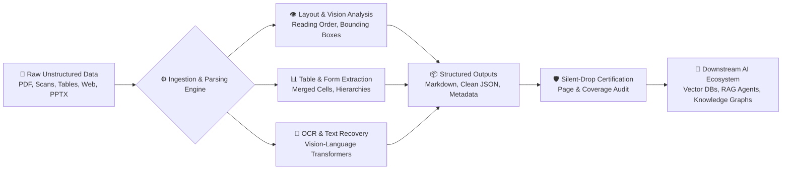

  

  
  
  
  
  
  
  

---

# 🚀 Awesome Unstructured Data Ingestion Engines

> **The Definitive Ecosystem Guide to Document Parsing, Vision OCR, Layout Extraction, Web Ingestion, and Multimodal LLM/RAG Data Pipelines.**  
> *Curated for Data Engineers, AI Architects, and RAG Builders transforming complex PDFs, scans, office formats, and web content into clean structured Markdown & JSON.*

---

## 📑 Table of Contents

- [🌟 Executive Summary & Architecture Overview](#-executive-summary--architecture-overview)
- [📊 Sector Overview & Market Dynamics](#-sector-overview--market-dynamics)
- [🏢 SaaS & Managed Document Ingestion Platforms](#-saas--managed-document-ingestion-platforms)
  - [SaaS Platforms Comparison Table](#saas-platforms-comparison-table)
  - [Detailed SaaS Platform Deep Dives](#detailed-saas-platform-deep-dives)
- [💻 Open-Source Ingestion Engines & Libraries](#-open-source-ingestion-engines--libraries)
  - [Open-Source Repositories Ranked by GitHub Stars](#open-source-repositories-ranked-by-github-stars)
  - [Detailed Open-Source Profiles](#detailed-open-source-profiles)
- [🧭 Decision Matrix: Choosing the Right Engine](#-decision-matrix-choosing-the-right-engine)
- [❓ Frequently Asked Questions (FAQ)](#-frequently-asked-questions-faq)
- [🤝 How to Contribute](#-how-to-contribute)
- [⚖️ Disclaimer & Compliance](#️-disclaimer--compliance)

---

## 🌟 Executive Summary & Architecture Overview

Modern **Generative AI (GenAI)**, **Retrieval-Augmented Generation (RAG)**, and **Autonomous AI Agents** are only as reliable as the quality of their ingested context. Real-world enterprise knowledge is trapped in unstructured documents — complex multi-column PDFs, degraded image scans, financial tables with merged cells, slide presentations, and dynamic JavaScript web pages.

**Unstructured Data Ingestion Engines** bridge this gap by transforming messy source files into deterministic, LLM-ready structures (clean Markdown, hierarchical JSON schemas, and semantic chunk embeddings).

---

## 📊 Sector Overview & Market Dynamics

The global **Intelligent Document Processing (IDP)** and unstructured data ingestion market is experiencing exponential growth, transitioning rapidly from traditional rule-based OCR to agentic Vision-Language Models (VLMs).

- **📈 Market Size & Projections:** The market is valued at approximately **$3.9B to $4.3B in 2026** (with North America representing ~42% of global volume) and is projected to expand to between **$29.7B and $88.9B by 2033–2034**, advancing at a staggering compound annual growth rate (**CAGR of 26.8% – 33.8%**).
- **🧩 Market Fragmentation vs. Concentration:** The sector is **moderately to highly fragmented** rather than a winner-take-all monopoly. While cloud hyperscalers (Microsoft Azure, Google Cloud, and AWS) command immense volume for commodity OCR and basic structured forms, high-margin GenAI-native startups (such as Unstructured.io, LlamaParse, Firecrawl, and Reducto) hold defensible technological moats in complex layout preservation, agentic web crawling, table reconstruction, and RAG chunking. Simultaneously, a vigorous **open-source ecosystem** provides sovereign, air-gapped on-premise alternatives that prevent vendor lock-in and per-page API tax.

---

## 🏢 SaaS & Managed Document Ingestion Platforms

Managed ingestion platforms deliver turnkey APIs, cloud scalability, OCR fine-tuning, and enterprise security certifications (SOC 2 Type II, HIPAA, ISO 27001).

### SaaS Platforms Comparison Table

*The table below is sorted descending by **Company Scale (Valuation / Market Capitalization)**.*

| 🏷️ Platform | 🏛️ Company Scale / Valuation | 🎯 Core Focus & Capabilities | 💵 Starting Tier Pricing *(Specific)* | 🎁 Free Tier / Free Trial Limits *(Specific)* | 🔒 Deployment Options |
| :--- | :--- | :--- | :--- | :--- | :--- |
| **[Azure AI Document Intelligence](https://azure.microsoft.com/en-us/products/ai-services/ai-document-intelligence)** | **~$3.12T** Market Cap *(Microsoft)* | Enterprise document intelligence, prebuilt tax/invoice/ID models, layout & reading order | **$1.50 per 1,000 pages** ($0.0015/page) for Read/Layout API; $10/1k pages for Prebuilt models | **Free F0 Tier forever**: 500 pages per month (rate limit: 2 transactions per second) | Multi-tenant Cloud, Disconnected Containers |
| **[Google Document AI](https://cloud.google.com/document-ai)** | **~$2.14T** Market Cap *(Alphabet)* | Multimodal OCR, specialized invoice/receipt parsing, document splitters & classifiers | **$1.50 per 1,000 pages** ($0.0015/page) for Document OCR; $30/1k pages for Form Parser | **Free forever**: 1,000 pages per month for Document OCR & Form Parser (plus $300 new customer credits) | Google Cloud, VPC Service Controls |
| **[AWS Textract](https://aws.amazon.com/textract/)** | **~$1.95T** Market Cap *(Amazon)* | OCR text extraction, key-value form detection, table structure synthesis, query extraction | **$1.50 per 1,000 pages** ($0.0015/page) for Detect Document Text; $15/1k pages for Tables | **AWS Free Tier (3 months)**: 1,000 pages/month for Text API + 100 pages/month for Tables & Forms | AWS Cloud, AWS PrivateLink |
| **[Landing AI](https://landing.ai/)** | **~$300M** Valuation *($57M raised; Andrew Ng)* | Agentic Document Extraction (ADE) Gen2, hierarchical block structures, Markdown pointers | **$0.01 per credit** ($10 per 1,000 credits; standard document extraction costs 1 credit/page) | **Explore Plan forever**: 1,000 free credits upon signup (no credit card required) | Cloud API, Dedicated VPC |
| **[Unstructured.io](https://unstructured.io/)** | **~$250M** Valuation *($65M raised; Series B)* | Document partitioning, vision transformer models, semantic chunking, 30+ enterprise connectors | **$0.015 per page** (Pay-As-You-Go self-serve API plan) | **Free Plan**: 10,000 free pages total credit on signup (no credit card required) | Cloud SaaS, Dedicated VPC, In-VPC |
| **[LlamaParse](https://www.llamaindex.ai/)** | **~$80M** Valuation *($12.5M raised; LlamaIndex)* | GenAI-native parser for RAG/Agents, table recognition, custom extraction prompts, JSON/Markdown | **$0.003 per page** ($3 per 1,000 pages; 1 credit/page on Fast mode; 3 credits/page Cost Effective) | **Free Tier forever**: 1,000 pages per day (~30,000 pages per month free allowance) | Cloud API |
| **[Firecrawl](https://www.firecrawl.dev/)** | **~$50M** Valuation *($10M+ raised; Benchmark)* | Web crawling & scraping API for LLMs, dynamic JS rendering, Cloudflare bypass, subpage mapping | **$16.00 per month** ($11/mo billed annually) for Hobby tier (includes 3,000 scraping credits/month) | **Free Plan forever**: 500 scraping credits on signup (full JS rendering & bypass included) | Cloud API, Self-Hosted Docker |
| **[Reducto](https://reducto.ai/)** | **~$40M** Valuation *($8.4M raised; YC W24)* | Agentic document extraction, layout-aware OCR, complex table parsing, bounding-box citations | **$0.01 per page** ($10 per 1,000 pages on Parse API; 20% discount on batch jobs: $0.008/page) | **Free Plan**: 15,000 free pages/credits on signup without credit card | Cloud, VPC, On-Prem, Air-Gapped |
| **[Docsumo](https://docsumo.com/)** | **~$25M** Valuation *($4.2M raised; $2.5M+ ARR)* | IDP with autonomous agent builder, multi-step validation, human-in-the-loop review UI | **$299.00 per month** (Growth Plan starting tier for up to 1,500 document pages/month) | **Free Trial (14 days)**: 1,000 free pages and 10 user licenses included (no credit card required) | Cloud SaaS, Hybrid |
| **[Sensible](https://sensible.so/)** | **~$15M** Valuation *($3.5M raised; Menlo)* | Developer-first extraction, SenseML query language, hybrid LLM + layout rules, validation engine | **$449.00 per month** (Growth Tier starting tier for up to 2,000 documents/month, $0.22/doc overage) | **Free Trial (14 days)**: Full platform access and sandbox API key testing (no credit card required) | Cloud SaaS |

---

### Detailed SaaS Platform Deep Dives

<b>🔍 Click to expand detailed technical profiles of each SaaS platform</b>

 

- **[Unstructured.io](https://unstructured.io/)**  
  Leading document ingestion platform with API for partitioning, enrichment, chunking, and embedding files into AI-ready data. Features production-grade vision transformer models, fine-tuned OCR, by-page and by-similarity chunking, and compliance (SOC 2 Type 2, HIPAA, GDPR, ISO 27001, FedRAMP). Business plans include SaaS, dedicated VPC, and in-VPC deployment.
- **[LlamaParse](https://www.llamaindex.ai/)**  
  GenAI-native document parser from LlamaIndex designed specifically for RAG and agent workflows. Supports PDF, PPTX, DOCX, XLSX, and HTML with table recognition, multimodal parsing (images/diagrams), and custom parsing prompts. V2 features tier-based pricing: Fast (1 credit/page), Cost Effective (3 credits/page), Agentic (10 credits/page), and Agentic Plus (45 credits/page).
- **[Firecrawl](https://www.firecrawl.dev/)**  
  The leading web scraping and ingestion API engineered specifically for AI applications. Converts entire websites and dynamic single-page applications into clean Markdown, structured JSON, or LLM-ready chunks. Features scrape, crawl, map, search, and agent endpoints with automated Cloudflare and antibot bypass.
- **[Reducto](https://reducto.ai/)**  
  Agentic document platform for complex PDFs, financial statements, and scans. Delivers layout-aware OCR, table extraction with merged cells, handwriting recognition, and bounding-box citations. Independently benchmarked #1 in LongExtractBench with 99.6% precision/recall across 225 documents averaging 358 pages.
- **[Landing AI](https://landing.ai/)**  
  Agentic Document Extraction (ADE) Gen2 spearheaded by AI pioneer Andrew Ng. Parse and Extract APIs provide hierarchical block structure, stable IDs, Markdown span pointers, and standardized outputs (HTML tables, checkbox states). Two service tiers: Standard (0.5x price) and Priority.
- **[Docsumo](https://docsumo.com/)**  
  Intelligent document processing with an official MCP (Model Context Protocol) server for AI agent integration. Agents Builder automates multi-step workflows: ingestion → classification → extraction → validation → export. Features configurable schema fields, fraud checks, and human-in-the-loop approvals.
- **[Sensible](https://sensible.so/)**  
  Developer-first document data extraction with SenseML query language combining LLM techniques and layout-based rules. Supports PDFs, emails, spreadsheets, and images with preprocessors, conditional extraction, validations, confidence scores, and human review UI.
- **[Azure AI Document Intelligence](https://azure.microsoft.com/en-us/products/ai-services/ai-document-intelligence)**  
  Microsoft's enterprise cloud service for document analysis with prebuilt and custom models for structured data extraction from forms, invoices, receipts, and identity documents.
- **[AWS Textract](https://aws.amazon.com/textract/)**  
  Amazon's managed ML service for extracting text, handwriting, tables, and forms from documents with tight integrations across the AWS AI and serverless ecosystem.
- **[Google Document AI](https://cloud.google.com/document-ai)**  
  Google Cloud's document understanding platform with pre-trained processors for procurement, tax forms, lending, and high-accuracy OCR.

---

## 💻 Open-Source Ingestion Engines & Libraries

Open-source document ingestion libraries are essential for organizations prioritizing **data sovereignty**, **zero per-page cloud costs**, **offline execution**, and **air-gapped compliance**.

### Open-Source Repositories Ranked by GitHub Stars

*Repositories are sorted descending by **GitHub Stargazers Count**.*

| 🏆 Project | 🌟 GitHub Stars Badge *(Click to Stargazers)* | 💻 Primary Stack | 📄 Key Capabilities | 📜 License |
| :--- | :--- | :--- | :--- | :--- |
| **[Firecrawl](https://github.com/mendableai/firecrawl)** |  | TypeScript / Python | Open-source web scraper & crawler API converting web pages into clean, LLM-ready Markdown & structured JSON | AGPL-3.0 |
| **[RAGFlow](https://github.com/infiniflow/ragflow)** |  | Python / C++ | Deep document understanding RAG engine with vision layout extraction across diverse multi-template formats | Apache-2.0 |
| **[PaddleOCR](https://github.com/PaddlePaddle/PaddleOCR)** |  | Python / C++ | Multilingual OCR toolkit with PaddleOCR-VL vision-language model, table recognition, and ONNX export | Apache-2.0 |
| **[MinerU](https://github.com/opendatalab/MinerU)** |  | Python / PyTorch | High-accuracy multimodal PDF extraction tool converting complex academic papers and books into clean Markdown | Apache-2.0 |
| **[Tesseract](https://github.com/tesseract-ocr/tesseract)** |  | C++ / C | The foundational open-source neural net (LSTM) optical character recognition engine supporting 100+ languages | Apache-2.0 |
| **[Docling](https://github.com/DS4SD/docling)** |  | Python | IBM Research parsing library; lightweight local extraction for digital PDFs, layout analysis, and clean Markdown | MIT |
| **[Marker](https://github.com/VikParuchuri/marker)** |  | Python / PyTorch | Converts PDFs and books to clean Markdown with 10x speed of traditional OCR; handles math formulas and code | GPL-3.0 |
| **[OCRmyPDF](https://github.com/ocrmypdf/OCRmyPDF)** |  | Python | Adds clean searchable OCR text layers and metadata to scanned PDF files while strictly preserving graphics | MPL-2.0 |
| **[EasyOCR](https://github.com/JaidedAI/EasyOCR)** |  | Python / PyTorch | Ready-to-use deep learning OCR supporting 80+ languages and scripts (CRAFT text detection + CRNN recognition) | Apache-2.0 |
| **[Surya](https://github.com/VikParuchuri/surya)** |  | Python / PyTorch | Multilingual document OCR, reading order detection, layout analysis, and dense tabular structure recognition | GPL-3.0 |
| **[Unstructured](https://github.com/Unstructured-IO/unstructured)** |  | Python | Open-source core powering Unstructured API; partitions, chunks, and filters PDFs, Word, PPTX, HTML, and emails | Apache-2.0 |
| **[PyMuPDF](https://github.com/pymupdf/PyMuPDF)** |  | Python / C | Ultra-fast PDF, XPS, and EPUB parsing engine providing rapid text extraction, drawing vector analysis, and images | AGPL-3.0 |
| **[pypdf](https://github.com/py-pdf/pypdf)** |  | Python | Pure-Python PDF extraction library; zero external binary dependencies, page splitting, merging, and metadata | BSD-3-Clause |
| **[Nougat](https://github.com/facebookresearch/nougat)** |  | Python / PyTorch | Meta AI's Neural Optical Understanding for Academic Documents; translates scientific document images into LaTeX | MIT |
| **[pdfminer.six](https://github.com/pdfminer/pdfminer.six)** |  | Python | Community-maintained Python PDF parser focused on exact text positioning, glyph fonts, and layout coordinates | MIT |
| **[DocTR](https://github.com/mindee/doctr)** |  | Python (TF / Torch) | Mindee's OCR library with end-to-end document reading, dense grid table detection, and reading-order linearization | Apache-2.0 |
| **[GROBID](https://github.com/kermitt2/grobid)** |  | Java / C++ | Machine learning parser for extracting and structuring bibliographic information and full-text academic papers | Apache-2.0 |
| **[Apache Tika](https://github.com/apache/tika)** |  | Java | Industrial-grade toolkit detecting and extracting metadata and structured text content across 1,000+ file formats | Apache-2.0 |
| **[pdfmux](https://github.com/NameetP/pdfmux)** |  | Python | Verification layer auditing parsers against source PDFs to catch silently dropped pages poisoning RAG indexes | MIT |
| **[hirara-web](https://github.com/lucasdmarshall/web_search)** |  | Python | Self-hosted web search & fetch service for AI agents with SSRF perimeter guard and untrusted content delimiters | MIT |
| **[Docxtract](https://github.com/mohammadmaso/Docxtract)** |  | Python / React | Self-hosted web app extracting structured JSON schema data from unstructured files using multi-LLM providers | MIT |
| **[harvest-agent](https://github.com/zad111ak-ai/harvest)** |  | Python | AI web scraper with Cloudflare bypass and local LLM extraction for zero external API cost workflows | MIT |
| **[universal-doc-parser](https://github.com/Edge-Explorer/Parse-Anything-)** |  | Python | Streaming document parser with bounded memory (&lt;250 MB RSS) and FastMCP server for Claude Desktop | MIT |

---

### Detailed Open-Source Profiles

<b>🛠️ Click to expand detailed capability descriptions for each open-source project</b>

 

- **[Firecrawl](https://github.com/mendableai/firecrawl)** — Turns any website into LLM-ready markdown or structured data. Handles dynamic JavaScript rendering, automated proxy rotation, bot bypass, and recursively crawls sitemaps or nested links.
- **[RAGFlow](https://github.com/infiniflow/ragflow)** — Open-source RAG engine based on deep document understanding. Extracts content from complex multi-format documents (PDFs, docs, presentations) using layout analysis and OCR, organizing findings into structured tables and readable blocks.
- **[PaddleOCR](https://github.com/PaddlePaddle/PaddleOCR)** — Ultra-lightweight and industrial OCR toolkit featuring the PaddleOCR-VL vision-language model. Supports 80+ languages, table structure parsing (PP-Structure), ONNX export, and local GPU acceleration.
- **[MinerU](https://github.com/opendatalab/MinerU)** — Highly capable open-source document extraction tool that converts multi-modal documents (including academic papers with formulas, equations, and multi-column layouts) into high-fidelity Markdown.
- **[Tesseract](https://github.com/tesseract-ocr/tesseract)** — The industry standard optical character recognition engine. Utilizes LSTM neural network models for text line detection and Unicode character recognition.
- **[Docling](https://github.com/DS4SD/docling)** — IBM Research's document parser designed for fast, local-first document extraction. Parses digital PDFs, Word documents, and presentations into clean Markdown and structured JSON.
- **[Marker](https://github.com/VikParuchuri/marker)** — Converts PDFs, EPUBs, and books into clean Markdown. Handles mathematical equations (outputting proper LaTeX), table extraction, code blocks, and multi-column reading orders.
- **[OCRmyPDF](https://github.com/ocrmypdf/OCRmyPDF)** — Adds an OCR text layer to scanned PDF files, generating searchable and indexable PDFs while validating output conformance with PDF/A standards.
- **[EasyOCR](https://github.com/JaidedAI/EasyOCR)** — PyTorch-based OCR library providing ready-to-run character recognition with support for over 80 languages, including Latin, Chinese, Arabic, Devanagari, and Cyrillic scripts.
- **[Surya](https://github.com/VikParuchuri/surya)** — Specialized deep learning library for document OCR, layout segmentation, reading-order linearization, and table structure detection across 90+ languages.
- **[Unstructured Open Source](https://github.com/Unstructured-IO/unstructured)** — The open-source foundation for unstructured data preprocessing. Offers modular pipelines to partition, clean, chunk, and enrich 20+ file types for RAG vector stores.
- **[PyMuPDF](https://github.com/pymupdf/PyMuPDF)** — High-performance Python bindings for MuPDF. Extracts text, embedded raster/vector images, metadata, font dictionaries, and form annotations at millisecond speeds.
- **[pypdf](https://github.com/py-pdf/pypdf)** — Pure-Python library with zero system dependencies for reading, extracting text, merging, encrypting, and manipulating PDF files.
- **[Nougat](https://github.com/facebookresearch/nougat)** — Meta AI's visual transformer model trained on scientific PDFs. Transcribes formulas, tables, and structured academic layouts directly into LaTeX and Markdown.
- **[pdfminer.six](https://github.com/pdfminer/pdfminer.six)** — Focused on extracting exact typography, font metrics, line coordinates, and text stream trees from complex digital PDFs.
- **[DocTR](https://github.com/mindee/doctr)** — End-to-end document reading library by Mindee supporting PyTorch and TensorFlow, featuring text detection, recognition, and dense grid table detection.
- **[GROBID](https://github.com/kermitt2/grobid)** — Machine-learning parser specialized in parsing headers, citations, references, and structured sections from academic PDF literature into TEI XML.
- **[Apache Tika](https://github.com/apache/tika)** — The battle-tested content detection and extraction toolkit supporting more than 1,000 distinct MIME file formats.
- **[pdfmux](https://github.com/NameetP/pdfmux)** — Audits extraction outputs against source PDFs to catch silently dropped pages, incomplete paragraphs, or missed tables before they corrupt vector embeddings.
- **[hirara-web](https://github.com/lucasdmarshall/web_search)** — Self-hosted web search and fetch service for AI agents with built-in SSRF protection, robots.txt compliance, and untrusted delimiter isolation.
- **[Docxtract](https://github.com/mohammadmaso/Docxtract)** — Full-stack web application with visual drag-and-drop schema builder to extract typed JSON structures from documents using OpenAI, Anthropic, or local Ollama LLMs.
- **[harvest-agent](https://github.com/zad111ak-ai/harvest)** — Open-source CLI web scraper with Cloudflare bypass and local LLM extraction for zero external API cost workflows.
- **[universal-doc-parser](https://github.com/Edge-Explorer/Parse-Anything-)** — Memory-bounded streaming document parser (&lt;250 MB RSS) featuring an integrated FastMCP server for Claude Desktop.

---

## 🧭 Decision Matrix: Choosing the Right Engine

| Use Case Scenario | Recommended Tool | Key Justification |
| :--- | :--- | :--- |
| **High-volume financial reports with nested tables** | **[Reducto](https://reducto.ai/)** or **[Landing AI](https://landing.ai/)** | 99%+ precision on merged cells, bounding-box citations, and audited extraction |
| **Turnkey RAG pipeline with multimodal documents** | **[LlamaParse](https://www.llamaindex.ai/)** or **[Unstructured.io](https://unstructured.io/)** | Native chunking, LlamaIndex integration, 1,000 free pages/day, Vision OCR |
| **Air-gapped on-premise document processing** | **[Docling](https://github.com/DS4SD/docling)** or **[PaddleOCR](https://github.com/PaddlePaddle/PaddleOCR)** | Open source, zero data egress, local GPU/CPU execution, permissive licenses |
| **Academic papers with math & formulas** | **[MinerU](https://github.com/opendatalab/MinerU)** or **[Nougat](https://github.com/facebookresearch/nougat)** | SOTA formula transcription to LaTeX, multi-column reading order preservation |
| **Web scraping dynamic JS for LLM ingestion** | **[Firecrawl](https://github.com/mendableai/firecrawl)** | Automated headless browser rendering, Cloudflare bypass, subpage map-crawl |
| **Catching silently dropped pages in RAG** | **[pdfmux](https://github.com/NameetP/pdfmux)** | Pre-ingestion audit engine verifying coverage before vector DB indexing |

---

## ❓ Frequently Asked Questions (FAQ)

### 1. What is an Unstructured Data Ingestion Engine?
An unstructured data ingestion engine is a specialized software system (SaaS API or self-hosted library) that parses semi-structured and unstructured formats (PDFs, scans, Office docs, web pages) into clean, layout-aware structured text (Markdown, JSON, tables) optimized for LLMs and vector search engines.

### 2. Why is traditional OCR not enough for modern RAG pipelines?
Traditional OCR engines (like legacy Tesseract) perform raw character recognition without understanding semantic hierarchy, reading order, multi-column flow, or complex table boundaries. When fed into an LLM chunker, traditional OCR produces broken tables, mixed reading orders, and hallucinations. Modern ingestion engines utilize Vision-Language Models (VLMs) and layout analysis to preserve meaning.

### 3. How do I prevent silently dropped pages from corrupting my vector database?
Many parsers fail silently on complex pages without raising an HTTP error. Using auditing tools like **[pdfmux](https://github.com/NameetP/pdfmux)** allows developers to run pre-indexing certifications comparing source page counts and text bounding boxes against parsed outputs to flag incomplete extractions.

### 4. When should I choose Open-Source over SaaS?
Choose **Open-Source** (such as Docling, MinerU, or PaddleOCR) if you have strict compliance/HIPAA requirements prohibiting external API calls, require air-gapped deployments, or process millions of pages where SaaS per-page costs exceed infrastructure costs. Choose **SaaS** if you want zero maintenance, immediate accuracy out-of-the-box, and SLA guarantees.

---

## 🤝 How to Contribute

Contributions are welcome! Help us keep this directory the most comprehensive resource in the AI ingestion ecosystem:

1. 🍴 **Fork the repository**.
2. 🌿 **Create a new branch**: `git checkout -b feature/add-new-engine`.
3. ✏️ **Add your entry** under the appropriate SaaS or Open-Source section:
   - Ensure open-source projects include their official GitHub repo and star badge.
   - For SaaS products, provide exact starting tier pricing and specific free trial/tier limits.
4. 🚀 **Submit a Pull Request** with a concise description of why the tool is valuable.

---

## ⚖️ Disclaimer & Compliance

- This repository is a **community-curated guide** intended for research, educational, and developer evaluation purposes. Inclusion does not imply official endorsement.
- All trademarks, logos, and brand names are the property of their respective owners.
- When processing enterprise data, ensure compliance with applicable regulations, including **GDPR**, **CCPA**, **HIPAA**, and **SOC 2 Type II**.
- Always verify terms of service, robots.txt directives, and API rate limits when deploying web crawlers and scraping engines.

---

  <b>⭐ Star this repository if you find it helpful for your AI and data engineering stack! ⭐</b>

